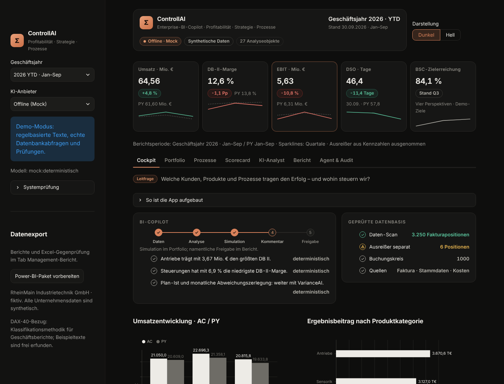
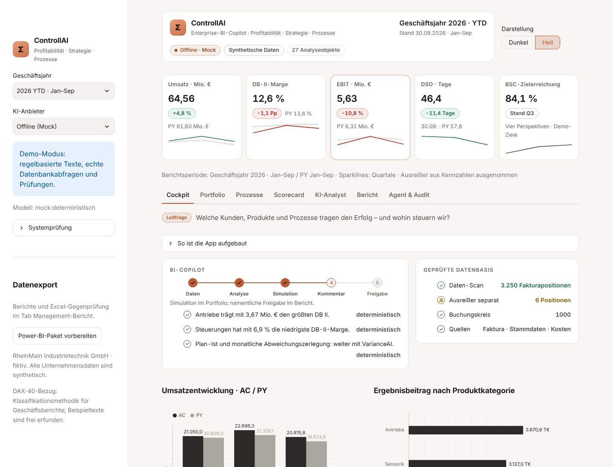
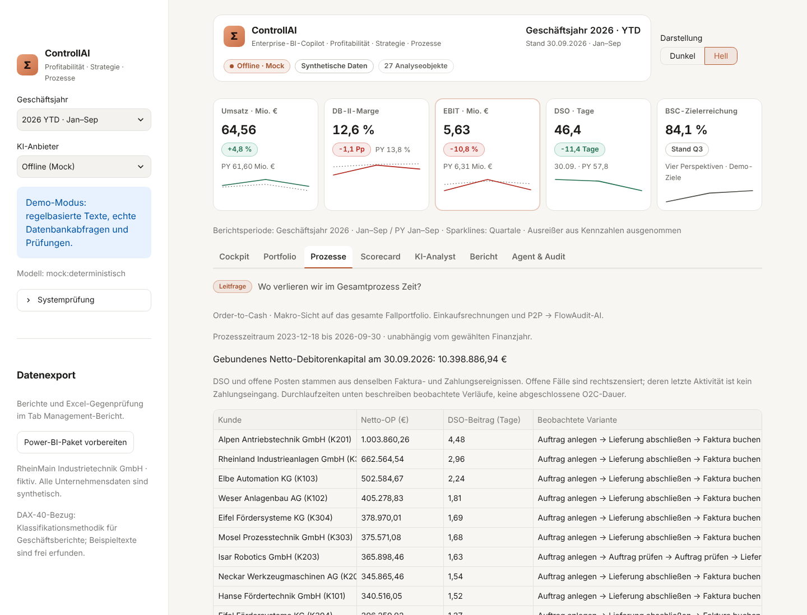
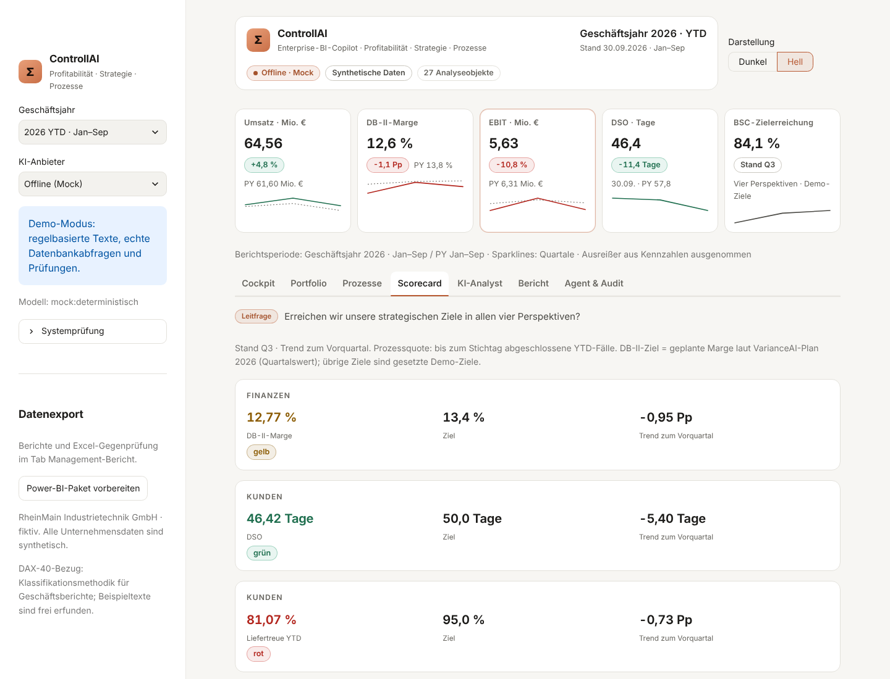

# Σ ControllAI · 2.2.1

**Profitabilität · Strategie · Prozessportfolio**

Welche Kunden, Produkte und Prozesse tragen den Erfolg – und wohin steuern wir?

Die Qualitätskorrektur und Order-to-Cash sind abgeschlossen. Alle Unternehmensdaten sind synthetisch;
keine Veröffentlichung. ControllAI verbindet Profitabilität, Strategie und O2C auf derselben Belegbasis.




## Start im Browser oder auf dem Mac

```bash
uv sync --locked
uv run python run_agent.py diagnose
uv run streamlit run app.py
```

Offline (Mock) ist ohne API-Schlüssel vollständig nutzbar. Entwicklungsvorgabe: Python 3.12;
getestete Zielversionen: 3.11 und 3.13. Eine Zielversion lässt sich mit `uv sync --locked --python 3.11` wählen;
bei nachfolgenden `uv run`-Befehlen dieselbe `--python`-Option verwenden.

Lokaler Browser mit gespeicherter Darstellung:

```bash
AGENT_LAUFZEIT=lokal uv run streamlit run app.py
```

Mac-Starter (Projektordner danach nicht verschieben):

```bash
uv run python -m desktop.build_app
```

Die App wird lokal in `~/Applications/ControllAI.app` angelegt. Der Starter öffnet einen lokalen Server
auf 127.0.0.1 und beendet ihn beim Schließen. Im Webbetrieb ist das Thema fest dunkel; lokal und im
Desktopbetrieb gibt es den gespeicherten Hell/Dunkel-Umschalter. Schriften werden lokal mitgeliefert.

## Daten und Suite-Abgrenzung

RheinMain Industrietechnik GmbH, fiktiv. Geschäftsjahre 2024/2025 vollständig, **2026 YTD bis 30.09.2026**.
Standard ist 2026; PY bedeutet ebenfalls Januar–September 2025. Ab 2.2.0 sind Umsatz, Herstellkosten (DB I),
Kostenstellenkosten, EBIT und der Plan 2026 centgenau mit VarianceAI 1.2 (Seed 42) abgestimmt; SENX1 startet wie
dort am 04.04.2026. Ab 2.2.1 stimmen Umsatz und HK auch je Kunde mit VarianceAI überein (Zelle Quartal × Region ×
Produktgruppe × Kunde). Einzelbelege, Zahlungen und O2C sind ControllAI-eigen.

| Kennzahl 2025 | VarianceAI | ControllAI 2.1 | ControllAI 2.2.1 |
|---|---:|---:|---:|
| Umsatz | 83,87 Mio. € | 83,87 Mio. € | 83,87 Mio. € |
| DB-I-Marge | 55,40 % | 37,41 % | 55,40 % |
| EBIT | 8,72 Mio. € (10,40 %) | 14,07 Mio. € (16,77 %) | 8,72 Mio. € (10,40 %) |
| Umsatz K201 | 11,36 Mio. € | 10,06 Mio. € | 11,36 Mio. € |

Kette der Suite: DataGuard-AI → FlowAudit-AI → VarianceAI → ControllAI.

| Agent | Verantwortung |
|---|---|
| DataGuard-AI | Stammdatenqualität (Kreditoren/Debitoren), Dubletten, Golden Record, S/4HANA-Readiness (CVI) |
| VarianceAI | Monatsabschluss, Plan-Ist, Preis/Menge/Mix, Forecast |
| FlowAudit-AI | E-Rechnung, Einzelbeleg-P2P, Matching, Klärfälle, Skonto |
| ControllAI | Profitabilität, Jahres-/YTD-Portfolio, Strategie, O2C, OP/DSO und Liefertreue |

Referenzwerte und Entscheidungen: [Suite-Abstimmung](docs/Suite-Abstimmung.md),
[Änderungsprotokoll](docs/Aenderungsprotokoll.md). Die beiden Referenzagenten wurden nicht verändert.

## Sieben Seiten

| Seite | Inhalt |
|---|---|
| Cockpit | Kennzahlen, periodenreiner AC/PY-Vergleich, Datenqualität, Faktenentwurf |
| Portfolio | DB I–III nach Kunde/Region/Produkt, ABC/Pareto und Was-wäre-wenn-Simulation |
| Prozesse | O2C-Portfolio, OP-/DSO-Treiber, Engpässe, Varianten und faktengeprüfte BPMN-Vorschläge |
| Scorecard | Vier Perspektiven, Ziele/Trend; BSC-Textanalyse als Unterbereich |
| KI-Analyst | Deutsche Frage, geprüfte lesende SQL-Abfrage, Ergebnis und Zahlenprüfung |
| Bericht | Faktenkommentar, namentliche Freigabe, PowerPoint/PDF/Excel auf Knopfdruck |
| Agent & Audit | Sieben Agentenkarten, Berichtstrichter, Ausschlussgründe und getrennte Sicherheitstests |

Beträge in Diagrammen stehen in T€ mit einer Nachkommastelle; Tabellen verwenden deutsche Bezeichnungen
und Dezimalkomma. Kunden und Materialien erscheinen mit Namen und ergänzender Nummer.

## Fachliche Definitionen

- DB I = Umsatz − variable Herstellkosten (VarianceAI-Konto 700000). DB II = DB I − Erzeugnisfixkosten
  (Fertigung 4100–4300 und Qualitätssicherung 4500). DB III = DB II − Unternehmensfixkosten (Instandhaltung 4400).
  Summe DB III = EBIT = Umsatz − HK − alle Kostenstellenkosten, identisch mit VarianceAI.
  Cent-Allokation erfolgt vor Filtern und bleibt additiv.
- Schlüssel: Fertigung nach Herstellkosten; Qualitätssicherung auf Produktkategorien nach Herstellkosten, auf
  Kunden nach Demo-Servicegewicht 12 (Kunden-Endziffer 4) bzw. 1; Instandhaltung nach positivem Umsatz.
  Diese Schlüssel sind Annahmen, kein Nachweis einer Verursachung. Ergebnis je Quartal/Produktkategorie in der
  Tabelle `produktfixkosten`.
- ABC verwendet positive DB-II-Beiträge; negative Beiträge sind C. Top-Fünftel wird auf volle Kunden aufgerundet.
- Simulation: Preis → Menge → Materialkosten → Fixkosten; Materialanteil 70 % als Demo-Annahme.
  Brückensumme = EBIT SIM − EBIT AC auf den Cent. Kein Nachfrage- oder Kapazitätsmodell.
- DSO = Netto-OP am gewählten Stichtag / Nettoumsatz der letzten 90 Tage × 90. Faktura, Zahlung und OP
  stammen aus derselben bereinigten Fakturaposition; Event-Log und Kennzahl stimmen auf den Cent überein.
- O2C: Auftrag → Lieferung → Faktura → Zahlung; feste Varianten aus Seed 42: Teillieferung, Gutschrift,
  Mahnung, Liefer-/Zahlungsverzug und Nacharbeit. Ein Fall ist eine Fakturaposition. Die Demo verwendet
  30 Tage Zahlungsziel und Zahlung nach 30 + 10 × Kunden-Endziffer Tagen. Keine Teilzahlungen, Steuer oder Bankabstimmung.
- Prozessanalyse zeigt den gesamten beobachteten Zeitraum. Offene Fälle sind rechtszensiert; beobachtete
  Dauern sind keine abgeschlossenen Zahlungszyklen. OP-Treiber verwenden dagegen den gewählten Jahresstichtag.
  Additive DSO-Beiträge je Kunde/Variante teilen denselben 90-Tage-Umsatznenner. Rangfolgen beweisen keine Kausalität.
- Gebundenes Kapital bezeichnet hier Netto-Debitoren-OP, nicht das gesamte Working Capital einschließlich Vorräten
  und Verbindlichkeiten. Gutschriften bleiben negativ. OP-Snapshots niemals über Stichtage aufsummieren.
- BSC: fünf Kennzahlen, vier gleichgewichtete Perspektiven. Kunden mittelt DSO und Liefertreue;
  Prozesse misst Nacharbeit in abgeschlossenen O2C-Fällen. Kennzahlen werden vor Perspektivaggregation auf
  0–100 % begrenzt. Grün ab 100 %, gelb ab 90 %, sonst rot. Fehlende Messung verhindert den Gesamtwert.
  Ziel DB-II-Marge 13,4 % = geplante Marge laut VarianceAI-Plan 2026; übrige Ziele sind Demo-Ziele.
  P2P verbleibt bei FlowAudit-AI; doppelte Makroanalyse entfällt.

Aktuelle Werte stammen aus [demolauf.json](docs/demolauf.json), Stand Seed 42 / September 2026.
2026 YTD: Umsatz 64.562.114,60 €, DB I 36.076.774,60 €, DB II 8.154.376,14 €, EBIT 5.629.259,60 € – wie VarianceAI.
DSO 46,42 Tage; Netto-OP 10.398.886,94 €; 3244 O2C-Fälle.
Die festen Suite-Referenzen (Umsatz, HK, Kostenstellen, EBIT) werden unabhängig vom Generator in Tests geprüft.
`tools/suite_referenz_erzeugen.py` erzeugt die Referenz aus VarianceAI, `tools/demolauf_erzeugen.py` den Nachweis.

## Freigaben, Sicherheit und Exporte

Fakten, Szenario und Freigaben bilden einen versionsgebundenen Kontext. Nur aktuell geprüfte, namentlich
freigegebene Kommentare gelangen in Management-Exporte. Änderungen machen alte Freigaben ungültig.
Namenseingabe dokumentiert Verantwortung, ersetzt aber keine Anmeldung oder elektronische Signatur.
Szenarien, Freigaben und Audit gelten für die Sitzung.

Der Audit-Trichter zählt dieselben aktuellen Kennzahlobjekte über alle Stufen; er zählt nicht Kunden oder
Transaktionszeilen. Demo-Wesentlichkeit: Geldbeträge ab 1.000 €, übrige gemessene Kennzahlen vollständig.
„Im Bericht“ zählt freigegebene Kommentar-Fakten im zuletzt vorbereiteten, noch aktuellen Export.
Ausschlussgründe werden je Kennzahl einmal gezählt, mit Vorrang für Schwelle und veralteten Datenstand.

SQL-Schutz: Parser, Tabellen-/Spalten-/Funktionsfreigaben, SQLite-Authorizer, Read-only-Verbindung,
Zeilen- und Zeitlimit. Unbelegte Zahlen in Modellantworten werden verworfen. Die numerische Prüfung
beweist keine Ursache oder allgemeine semantische Richtigkeit eines Textes.

Datentexte sind unvertrauenswürdig. Bekannte Injection-Anweisungszeilen werden vor dem BSC-Modellaufruf
quarantänisiert. Ein reiner Angriffstext erzeugt keine Initiative. Das ist keine universelle Erkennung
aller denkbaren Angriffe. Dynamische Texte werden als maskiertes HTML dargestellt.

Excel enthält Formeln, gespeicherte Rechenwerte, separate Python-Vergleiche und bedingte Statusformatierung.
Power BI liefert getrennte Ergebnis-/OP-/BSC-Fakten, Dimensionen und DAX. CSV: UTF-8-BOM, Semikolon,
Dezimalkomma und deutsche Stichtage. Technische Schlüssel bleiben im maschinenlesbaren Sternschema erhalten.
OP-Snapshots nicht über mehrere Stichtage summieren; DSO/BSC-DAX fordert eine einzelne Periode.

## Konfiguration und Datenordner

| Variable | Zweck |
|---|---|
| LLM_ANBIETER | mock, claude oder gemini; ohne Zugang bleibt Mock nutzbar |
| ANTHROPIC_API_KEY / GEMINI_API_KEY | Optionaler Anbieterzugang |
| LLM_MODEL | Modellkennung überschreiben |
| AGENT_LAUFZEIT | web, lokal oder desktop |
| AGENT_DATENORDNER | Basisordner für Daten und Einstellungen |
| DB_PATH | Eigene bestehende SQLite-Datenbank mit freigegebenem Schema |
| SQL_MAX_ROWS / SQL_TIMEOUT_SECONDS | Abfragelimits |
| SCHEMA_SAMPLE_ROWS | Beispielzeilen für das Modell; bei Unternehmensdaten auf 0 setzen |

Schlüsselvorrang: Umgebung > .env > lokaler macOS-Schlüsselbund. Keine Schlüsselwerte im Audit.
Die Abnahme verwendete ausschließlich Mock, keine kostenpflichtigen Modellaufrufe.

Standard lokal: `~/Library/Application Support/ControllAI/daten-v2.2/`.
Web-Demo: temporärer Ordner `ControllAI-demo-v2.2/daten-v2.2/`.
Vorherige Demo-Daten werden nicht überschrieben. Ein expliziter DB_PATH gewinnt und wird nicht automatisch migriert.
Er benötigt das zugehörige `sample/event_log_o2c.csv` mit derselben Belegbasis.
Produktive Daten benötigen einen geprüften Import, Schemafreigaben und eigene Integrationsentscheidungen.

## Aufbau und Prüfnachweise

app.py enthält Aufbau und Verdrahtung; Seiten liegen in ui_seiten, ui_strategie und ui_audit,
Datenzugriff/Cache in ui_daten und zwischenspeicher, Kennzahlen-Leiste in ui_kopf.
Bestehende englische Agentenkern-APIs bleiben für Integrationskompatibilität stabil.

```bash
uv run pytest -q
uv run ruff check .
uv run ruff check . --select E501
```

**436 Tests je Zielversion bestanden**, ohne übersprungene Tests: Python 3.11.18 in 67,21 s, Python 3.13.18 in 66,41 s (Cloud-Container). Erstlauf 5,566 s, Folgelauf 0,355 s, Jahreswechsel 0,278 s (lokaler Offline-AppTest).

Aktuelle Messungen: [Endabnahme](docs/Endabnahme.md), [Prüfergebnisse](docs/pruefergebnisse.json),
[Desktop-Referenzvergleich](docs/referenzvergleich.json). Historische Schritt-1-Abnahme bleibt als Verlauf erhalten.
Desktop einschließlich Ressourcen ist außer app.toml bytegleich mit VarianceAI.
Der vorhandene Ruff-Regelsatz bleibt unverändert; E501 wird zusätzlich separat geprüft.

Die Word-Dokumente **SAP-Anbindung.docx** und **Kennzahlen_und_Diagramme.docx** wurden für 2.2 neu erstellt
und aus dem aktuellen Demo-Lauf befüllt. Arabische Fassungen werden separat geliefert und gehören nicht ins Repository.
Nur **Leitfaden_Unternehmenseinsatz.docx** ist ein unveränderter historischer Leitfaden 2.0; für aktuelle
Zahlen und O2C gelten die neuen Dokumente. Alle 34 Seiten der vier Erklärdokumente wurden als PDF gerendert und geprüft.




Lizenz MIT; lokale Schriftdateien mit SIL-OFL-Lizenzen.
