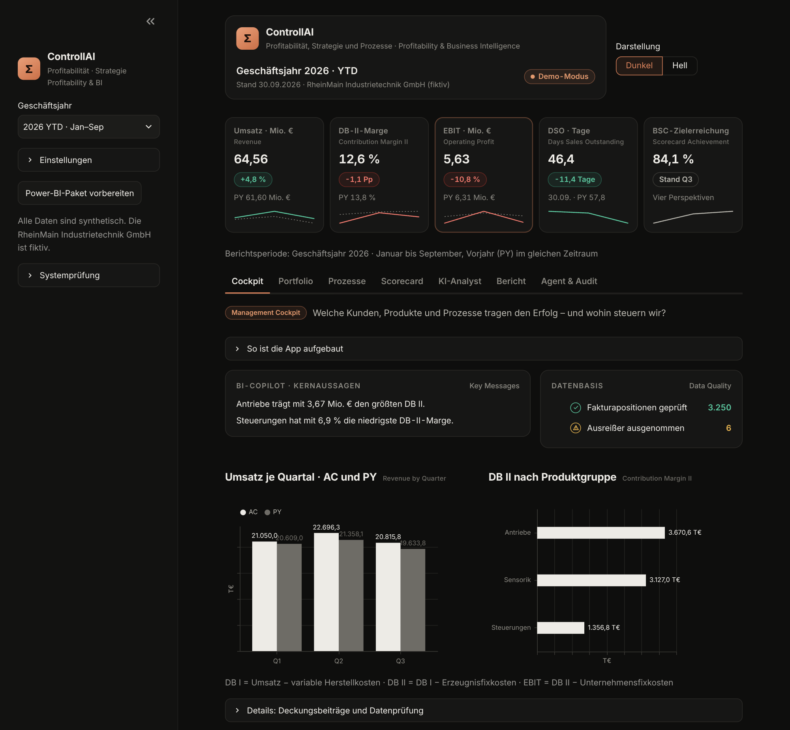
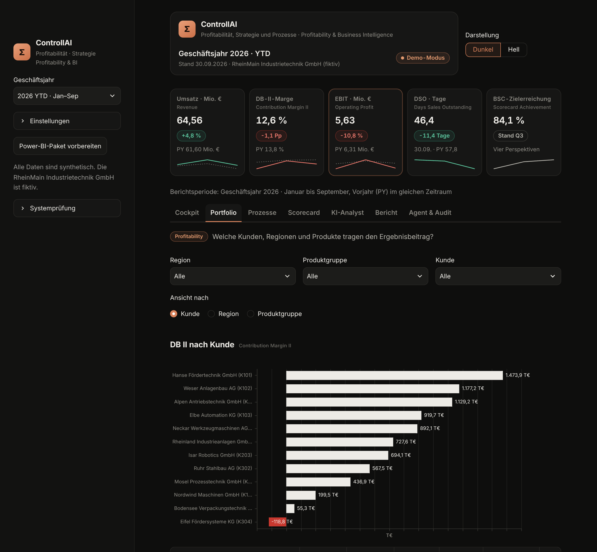
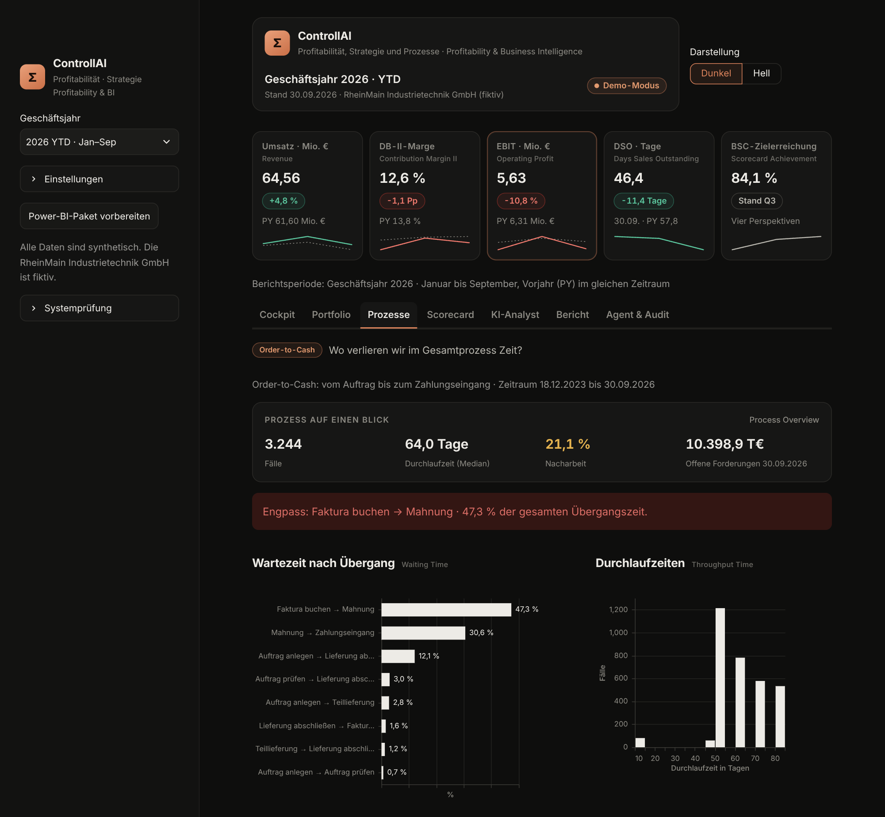
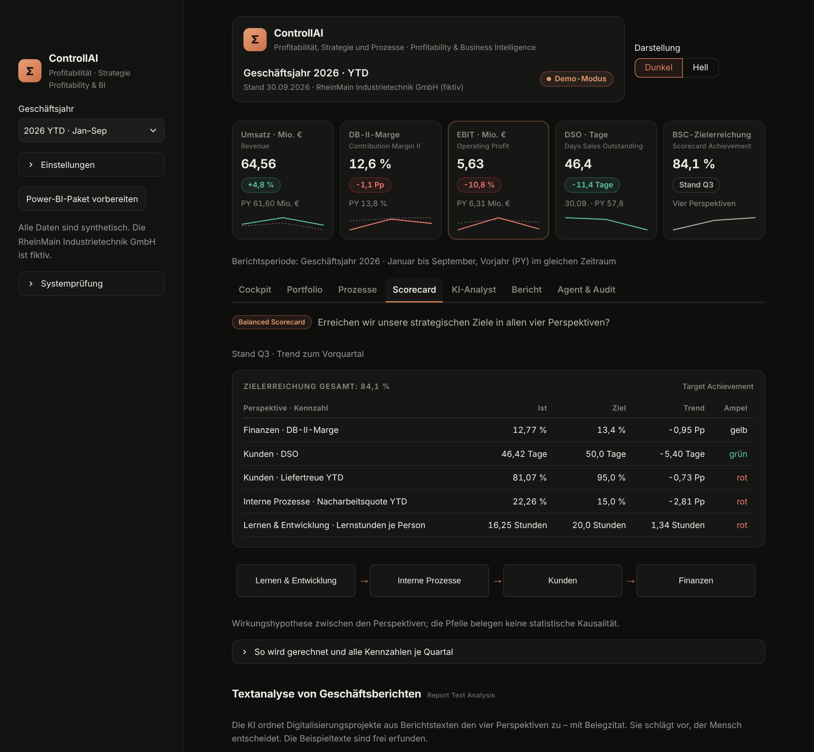
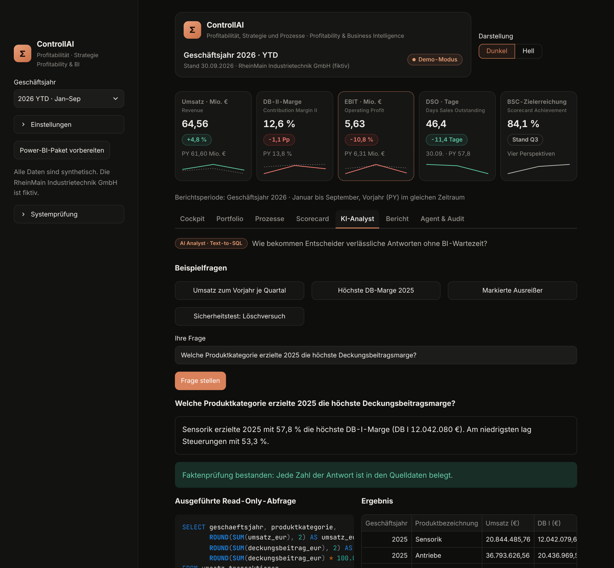
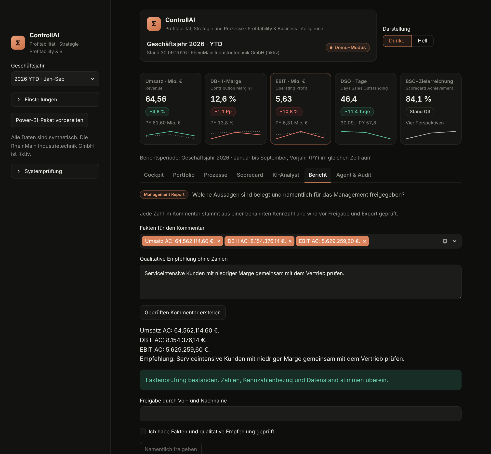
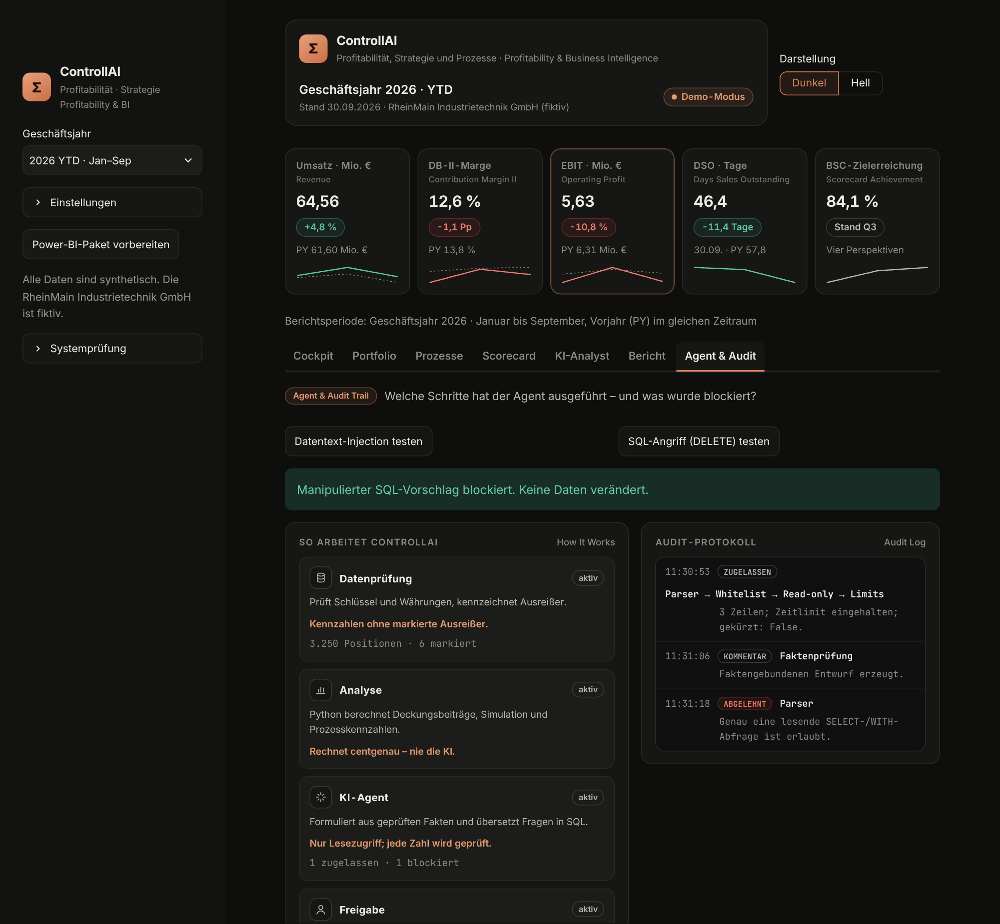
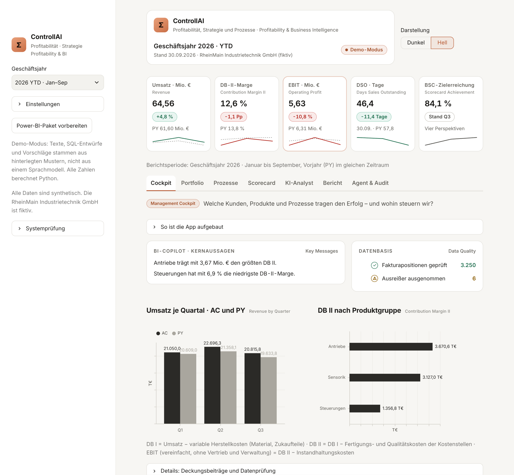

# ControllAI

**Profitabilität, Strategie und Prozesse für das Controlling – Deckungsbeitragsrechnung, ABC-Analyse, Order-to-Cash und Balanced Scorecard**

**Live-Demo:** <https://controll-ai-shweish.streamlit.app> · **Stack:** Python, SQL (SQLite), Streamlit, Excel, PowerPoint und Power BI (DAX)

[](../../actions/workflows/ci.yml)


> *Welche Kunden, Produkte und Prozesse tragen den Erfolg – und wohin steuern wir?*

**Kurzfassung:** ControllAI analysiert die Profitabilität eines fiktiven Industrieunternehmens: mehrstufige
Deckungsbeitragsrechnung (DB I–III) nach Kunde, Region und Produkt, ABC-/Pareto-Analyse, Order-to-Cash mit DSO und
eine Balanced Scorecard.

Fragen in deutscher Sprache werden in geprüfte SQL-Abfragen übersetzt; Ergebnisse gehen als Excel-, PowerPoint- und
Power-BI-Paket hinaus. Alle Zahlen berechnet Python; die KI formuliert nur, und jede Zahl wird automatisch geprüft.
Portfolio-Projekt mit synthetischen Daten.



---

## Inhalt

1. [Einblick](#einblick)
2. [Business Value](#business-value)
3. [Funktionsumfang](#funktionsumfang)
4. [Fachliche Methodik](#fachliche-methodik)
5. [KI-Analyst und Sicherheit](#ki-analyst-und-sicherheit)
6. [Freigabe und Export](#freigabe-und-export)
7. [Einordnung im Portfolio](#einordnung-im-portfolio)
8. [Installation & Schnellstart](#installation--schnellstart)
9. [Konfiguration](#konfiguration)
10. [Projektstruktur](#projektstruktur)
11. [Tests](#tests)
12. [Glossar Deutsch–Englisch](#glossar-deutschenglisch)
13. [Hinweise](#hinweise)

---

## Einblick

**Portfolio** – Deckungsbeiträge nach Kunde, Region und Produktgruppe, ABC-Analyse und Was-wäre-wenn-Simulation:



**Prozesse** – Order-to-Cash: Durchlaufzeit, Zeitanteile je Übergang, Nacharbeit und offene Forderungen nach Kunde:



**Scorecard** – Balanced Scorecard mit Ziel, Trend und Ampel; darunter die Textanalyse von Geschäftsberichten:



**KI-Analyst** – Frage auf Deutsch, geprüfte lesende SQL-Abfrage, Ergebnis und Faktenprüfung:



**Bericht** – Kommentar aus geprüften Kennzahlen mit namentlicher Freigabe:



**Agent & Audit** – Rollen und Regeln, der Weg von der Kennzahl zum Bericht, Sicherheitstests und Audit-Protokoll:



Darstellung hell (Umschalter oben rechts, lokal und in der Mac-App):



---

## Business Value

| Aufgabe im Controlling | Ohne Werkzeug | Mit ControllAI |
|---|---|---|
| Kunden- und Produktergebnis | Excel-Auswertungen je Anfrage, Kostenstellenkosten pauschal verteilt | DB I–III je Kunde, Region und Produktgruppe; Verteilung centgenau, Schlüssel offen ausgewiesen |
| Schwerpunkte erkennen | Listen sortieren, Bauchgefühl | ABC-/Pareto-Analyse mit Kunden mit negativem Deckungsbeitrag auf einen Blick |
| Entscheidungen vorbereiten | Szenarien einzeln nachrechnen | Simulation von Preis, Menge, Material- und Fixkosten mit EBIT-Brücke |
| Forderungen und Prozesse | DSO als Einzelzahl aus der Buchhaltung | Order-to-Cash-Analyse: Zeitanteile je Übergang, Nacharbeit und offene Forderungen je Kunde |
| Ad-hoc-Fragen der Fachbereiche | Warten auf eine BI-Auswertung | Frage auf Deutsch, Antwort aus einer geprüften, rein lesenden SQL-Abfrage |
| Management-Bericht | Zahlen von Hand übertragen | Kommentar aus benannten Kennzahlen, namentliche Freigabe, Export als PowerPoint, PDF, Excel und Power BI |

---

## Funktionsumfang

| Seite | Was sie leistet |
|---|---|
| **Cockpit** | Fünf Kennzahlen mit Vorjahresvergleich im gleichen Zeitraum, Kernaussagen, Umsatz je Quartal, DB II nach Produktgruppe |
| **Portfolio** | DB I–III nach Kunde, Region und Produktgruppe mit Filter, ABC-/Pareto-Analyse, Was-wäre-wenn-Simulation |
| **Prozesse** | Order-to-Cash aus dem Event-Log: Durchlaufzeit, Zeitanteile je Übergang, Varianten, offene Forderungen, BPMN-Verbesserungsvorschläge |
| **Scorecard** | Balanced Scorecard mit fünf Kennzahlen in vier Perspektiven; Textanalyse von Geschäftsberichten mit Belegzitat |
| **KI-Analyst** | Text-to-SQL: deutsche Frage, geprüfte lesende Abfrage, Ergebnis, Faktenprüfung der Antwort |
| **Bericht** | Kommentar aus geprüften Kennzahlen, namentliche Freigabe, Export als PowerPoint, PDF und Excel mit Formeln |
| **Agent & Audit** | Arbeitsweise des Agenten, Weg von der Kennzahl zum Bericht, Sicherheitstests, Audit-Protokoll |

Dazu: Betrieb im Browser und als Mac-App im eigenen Fenster, vollständiger Demo-Modus ohne API-Key, Darstellung hell
und dunkel, Power-BI-Paket im Sternschema mit DAX-Kennzahlen.

Die **Textanalyse von Geschäftsberichten** überträgt die Methodik meiner Bachelorarbeit (Klassifikation von
487 Digitalisierungsprojekten aus 120 Geschäftsberichten der DAX-40-Unternehmen nach den Perspektiven der Balanced
Scorecard) in ein Werkzeug: Die KI schlägt eine Perspektive mit Belegzitat vor, das Zitat wird im Originaltext geprüft,
und der Mensch entscheidet. Die Beispieltexte in der App sind frei erfunden.

---

## Fachliche Methodik

- **Ergebnisstufen:** DB I = Umsatz − variable Standardherstellkosten (Material, Zukaufteile). DB II = DB I − Kosten
  der Fertigungs- und Qualitätskostenstellen (4100–4300, 4500). DB III = DB II − Instandhaltungskosten (4400).
  Summe DB III = EBIT (vereinfacht) = Umsatz − Herstellkosten − alle Kostenstellenkosten; Vertriebs- und
  Verwaltungskosten bildet das Modell nicht ab. Die Verteilung erfolgt auf den Cent genau vor jedem Filter und
  bleibt additiv.
- **Kostenverhalten:** Die Kostenstellenkosten sind keine reinen Fixkosten. Material, Energie und Fertigungslöhne
  folgen der Beschäftigung (2026 YTD: 23,73 von 30,45 Mio. €, 77,9 %); Gehälter, Abschreibungen und
  Fremdinstandhaltung sind fix (6,72 Mio. €). Dieselbe Trennung nutzt VarianceAI in der flexiblen Plankostenrechnung.
  DB II und DB III sind deshalb eine Ergebnisrechnung mit geschlüsselten Kostenstellenkosten und keine
  verursachungsgerechte Kunden- oder Produktkalkulation.
- **Verteilungsschlüssel:** Fertigung nach Herstellkosten; Qualitätssicherung nach einem Servicegewicht je Kunde;
  Instandhaltung nach positivem Umsatz. Diese Schlüssel sind Annahmen der Demo, kein Nachweis einer Verursachung.
- **ABC-Analyse:** nach positivem DB II; A bis 80 %, B bis 95 %, Rest C. Negative Beiträge zählen zu C.
- **Simulation:** Reihenfolge Preis → Menge → Materialkosten → Fixkosten; Materialanteil 70 % als Demo-Annahme.
  Mit der Menge skalieren die variablen Herstellkosten **und** die beschäftigungsvariablen Kostenstellenkosten; der
  Fixkostenregler wirkt nur auf die fixen Kostenarten. Beispiel 2026 YTD: +10 % Menge verbessern das EBIT um
  1,23 Mio. € – würden alle Kostenstellenkosten als fix behandelt, wären es rechnerisch 3,61 Mio. €.
  Die Brückensumme entspricht der EBIT-Differenz auf den Cent. Kein Nachfrage- oder Kapazitätsmodell.
- **DSO:** Netto-Forderungen am Stichtag / Nettoumsatz der letzten 90 Tage × 90. Faktura, Zahlung und offene Posten
  stammen aus derselben Belegbasis; Event-Log und Kennzahl stimmen auf den Cent überein.
- **Order-to-Cash:** Auftrag → Lieferung → Faktura → Zahlung mit Varianten wie Teillieferung, Gutschrift, Mahnung und
  Nacharbeit. Ein Fall ist eine Fakturaposition. Offene Fälle sind noch nicht abgeschlossen; beobachtete Dauern sind
  deshalb keine vollständigen Zahlungszyklen. Rangfolgen beweisen keine Kausalität. Der größte Zeitanteil liegt
  zwischen Faktura und Mahnung; darin steckt das Zahlungsziel von 30 Tagen – vertragliche Wartezeit, kein
  Kapazitätsengpass. In den Demo-Daten zahlen alle Kunden nach Fälligkeit (40 bis 70 Tage); das ist bewusst
  vereinfacht.
- **Offene Forderungen** bezeichnen hier Netto-Debitoren, nicht das gesamte Working Capital mit Vorräten und
  Verbindlichkeiten.
- **Balanced Scorecard:** fünf Kennzahlen, vier gleichgewichtete Perspektiven. Grün ab 100 % Zielerreichung, Gelb ab
  90 %, sonst Rot. Fehlt eine Messung, gibt es keinen Gesamtwert. Das Ziel der DB-II-Marge stammt aus dem Plan 2026;
  die übrigen Ziele sind gesetzte Demo-Ziele.

**Daten:** RheinMain Industrietechnik GmbH, fiktiv. Geschäftsjahre 2024 und 2025 vollständig, 2026 bis 30.09.2026;
der Vorjahresvergleich nutzt denselben Zeitraum. 2026 YTD: Umsatz 64,56 Mio. €, DB II 8,15 Mio. €, EBIT 5,63 Mio. €,
DSO 46,4 Tage, 3.244 Order-to-Cash-Fälle. Die Werte eines frischen Demo-Laufs stehen in
[demolauf.json](docs/demolauf.json).

---

## KI-Analyst und Sicherheit

Die KI rechnet nicht. Sie übersetzt Fragen in SQL und formuliert Antworten; beides wird geprüft.
Im Demo-Modus ohne API-Key stammen SQL-Entwürfe, Texte und Klassifikationsvorschläge aus hinterlegten Mustern, nicht
aus einem Sprachmodell; die Oberfläche weist das aus. Prüfungen, Berechnungen und Sicherheitsgrenzen laufen echt.

- **SQL-Schutz in vier Schichten:** Parser (genau eine Anweisung, nur `SELECT`/`WITH`), Freigabeliste für Tabellen,
  Spalten und Funktionen, rein lesende Datenbankverbindung, Zeilen- und Zeitlimit je Abfrage.
- **Faktenprüfung:** Jede Zahl einer KI-Antwort muss im Abfrageergebnis oder in den Kennzahlen belegt sein; sonst
  wird der Text verworfen. Die Prüfung belegt Zahlen, nicht Ursachen.
- **Texte aus Daten sind keine Anweisungen:** Bekannte Injection-Zeilen in Berichtstexten werden vor dem Modellaufruf
  entfernt; dynamische Texte werden maskiert dargestellt. Das ist keine Erkennung aller denkbaren Angriffe.
- **Sicherheitstests per Knopfdruck** auf der Seite *Agent & Audit*: ein Löschversuch per SQL und eine versteckte
  Anweisung im Datentext. Beide werden blockiert und protokolliert.

---

## Freigabe und Export

Kennzahlen, Szenario und Freigabe gehören zusammen: Nur geprüfte, namentlich freigegebene Kommentare gelangen in den
Management-Bericht. Ändern sich Daten oder Szenario, wird die alte Freigabe ungültig. Die Namenseingabe dokumentiert
Verantwortung; sie ersetzt keine Anmeldung oder elektronische Signatur. Szenarien, Freigaben und Audit-Protokoll
gelten für die Sitzung.

- **PowerPoint und PDF:** Management-Bericht mit den freigegebenen Kommentaren.
- **Excel:** Formeln, gespeicherte Rechenwerte und ein Vergleich mit den Python-Ergebnissen.
- **Power BI:** Sternschema aus Fakten- und Dimensionstabellen mit DAX-Kennzahlen; CSV mit Semikolon, Dezimalkomma
  und UTF-8-BOM.

---

## Einordnung im Portfolio

ControllAI und VarianceAI bilden zusammen eine kleine Controlling-Suite: dasselbe fiktive Unternehmen und ein
gemeinsames Zahlenwerk (Buchungskreis 1000, Stichtag 30.09.2026).

| Projekt | Ebene | Kernfrage | Schwerpunkte |
|---|---|---|---|
| **VarianceAI** | Operatives Controlling & Reporting | Warum weicht das Ergebnis vom Plan ab – und wo landen wir am Jahresende? | Preis-/Mengen-/Mix-Analyse, Plankostenrechnung, Forecast, IBCS-Bericht |
| **ControllAI** | Profitabilität, Strategie & BI | Welche Kunden, Produkte und Prozesse tragen den Erfolg? | Deckungsbeitragsrechnung DB I–III, ABC/Pareto, Order-to-Cash mit DSO, Balanced Scorecard, Text-to-SQL |

Umsatz, Herstellkosten, Kostenstellenkosten und EBIT stimmen in beiden Projekten centgenau überein; das wird in den
Tests gegen feste Referenzwerte geprüft.

**Unterschiedliche Sicht auf dieselben Kostenstellen:** VarianceAI trennt die Kostenstellenkosten nach ihrem Verhalten
(beschäftigungsvariabel und fix) für die flexible Plankostenrechnung; ControllAI ordnet dieselben Kosten den
Ergebnisstufen DB II und DB III zu und nutzt dieselbe Trennung in der Simulation.

---

## Installation & Schnellstart

Voraussetzung: [uv](https://docs.astral.sh/uv/). Python 3.12 wird von uv bereitgestellt; getestet mit 3.11 bis 3.13.

```bash
uv sync --locked
uv run streamlit run app.py
```

Der Demo-Modus ist ohne API-Schlüssel vollständig nutzbar. Die synthetischen Daten werden beim ersten Start erzeugt.

Lokaler Browser mit Umschalter hell/dunkel und gespeicherter Darstellung:

```bash
AGENT_LAUFZEIT=lokal uv run streamlit run app.py
```

Mac-App im eigenen Fenster (Projektordner danach nicht verschieben):

```bash
uv run python -m desktop.launcher     # direkt starten
uv run python -m desktop.build_app    # ~/Applications/ControllAI.app anlegen
```

Der Starter öffnet einen lokalen Server auf 127.0.0.1 und beendet ihn beim Schließen. Schriften werden lokal
mitgeliefert. In der Online-Demo ist das Thema fest dunkel.

---

## Konfiguration

| Variable | Zweck |
|---|---|
| `LLM_ANBIETER` | `mock`, `claude` oder `gemini`; ohne Zugang bleibt der Demo-Modus nutzbar |
| `ANTHROPIC_API_KEY` / `GEMINI_API_KEY` | Optionaler Anbieterzugang |
| `LLM_MODEL` | Modellkennung überschreiben |
| `AGENT_LAUFZEIT` | `web`, `lokal` oder `desktop` |
| `AGENT_DATENORDNER` | Basisordner für Daten und Einstellungen |
| `DB_PATH` | Eigene SQLite-Datenbank mit freigegebenem Schema |
| `SQL_MAX_ROWS` / `SQL_TIMEOUT_SECONDS` | Abfragelimits |
| `SCHEMA_SAMPLE_ROWS` | Beispielzeilen für das Modell; bei Unternehmensdaten auf 0 setzen |

Schlüssel werden in dieser Reihenfolge gelesen: Umgebung, `.env`, macOS-Schlüsselbund. Im Audit-Protokoll stehen
keine Schlüsselwerte. Vorlage: [.env.example](.env.example).

---

## Projektstruktur

```text
ControllAI/
├── app.py                 Aufbau und Verdrahtung der sieben Seiten
├── run_agent.py           Kommandozeile: Diagnose und Demo-Lauf
├── src/
│   ├── agent.py           KI-Agent: Text-to-SQL, Faktenprüfung, Textklassifikation
│   ├── sql_pruefung.py    SQL-Schutz: Parser, Freigabelisten, Authorizer
│   ├── kostenstufen.py    Deckungsbeitragsstufen und Kostenverteilung auf den Cent
│   ├── strategie.py       Verdichtung, ABC-Analyse, Balanced Scorecard
│   ├── simulation.py      Was-wäre-wenn-Simulation
│   ├── o2c.py             Order-to-Cash, offene Forderungen, DSO
│   ├── analytics.py       Datenbereinigung, Ausreißer, Prozessanalyse
│   ├── kommentare.py      Faktenkommentar und namentliche Freigabe
│   ├── bericht_export.py  PowerPoint, PDF, Excel, Power BI
│   ├── audit.py           Audit-Protokoll mit Hash-Kette
│   ├── seed_data.py       Synthetische Daten (Seed 42)
│   └── ui_*.py            Oberfläche: Designsystem, Diagramme, Seiten
├── desktop/               Mac-App: eigenes Fenster über pywebview
├── tests/                 443 Tests
├── tools/                 Nachweis- und Referenzdaten erzeugen
├── docs/                  Standard, Quellen, Demo-Nachweis, Screenshots
└── .github/workflows/     Automatische Prüfung bei jedem Push
```

---

## Tests

```bash
uv run pytest -q
uv run ruff check .
```

**443 Tests**, vollständig offline und ohne API-Key. Bei jedem Push laufen ruff und pytest automatisch über GitHub
Actions auf Python 3.11 und 3.13. Geprüft werden unter anderem:

- **Rechenlogik:** Deckungsbeitragsstufen, Kostenverteilung ohne Cent-Differenz, ABC-Analyse, Simulation, DSO
- **Fachprüfung:** variable Kostenstellenkosten folgen der Menge, Vorjahresvergleich im gleichen Zeitraum,
  Musterempfehlungen passen zum Prozess, Demo-Antworten sind als solche gekennzeichnet
- **Abstimmung mit VarianceAI:** Umsatz, Herstellkosten, Kostenstellen und EBIT gegen feste Referenzwerte
- **SQL-Schutz:** schreibende Anweisungen, Kommentare, mehrere Anweisungen und nicht freigegebene Spalten werden abgelehnt
- **Faktenprüfung:** unbelegte Zahlen in KI-Texten, Zitate, deutsche Zahlenformate
- **Oberfläche:** jede Seite, Geschäftsjahreswechsel, Freigabe, Export und Sicherheitstests über `streamlit.testing`
- **Export:** PowerPoint, PDF, Excel mit Formeln, Power-BI-Paket

---

## Glossar Deutsch–Englisch

Die Oberfläche ist deutsch; die englischen Fachbegriffe stehen als Zweitbeschriftung an Seiten, Kennzahlen und Karten.

| Deutsch | Englisch |
|---|---|
| Deckungsbeitrag (DB I, II, III) | Contribution Margin (CM I, II, III) |
| Deckungsbeitragsrechnung | Contribution Margin Accounting |
| Umsatz · Herstellkosten · Fixkosten | Revenue · Cost of Goods Sold · Fixed Costs |
| ABC-Analyse | Pareto / ABC Analysis |
| Was-wäre-wenn-Simulation | What-if Simulation |
| Auftrag bis Zahlungseingang | Order-to-Cash (O2C) |
| Offene Forderungen | Open Receivables |
| Forderungslaufzeit | Days Sales Outstanding (DSO) |
| Durchlaufzeit · Zeitanteil · Nacharbeit | Throughput Time · Time Share · Rework |
| Balanced Scorecard, Zielerreichung | Balanced Scorecard, Target Achievement |
| Management-Bericht · Freigabe | Management Report · Approval |
| Audit-Protokoll | Audit Log |

---

## Hinweise

- ControllAI ist ein **Portfolio- und Demonstrationsprojekt** mit synthetischen Daten. Es ersetzt weder das
  Rechnungswesen noch die fachliche Prüfung durch qualifizierte Controller.
- KI-generierte Texte sind Entwürfe und müssen vor der Verwendung fachlich geprüft und freigegeben werden.
- Für echte Unternehmensdaten wären ein geprüfter Import, Schemafreigaben und eigene Integrationsentscheidungen nötig.
- Es werden keine Secrets im Repository gespeichert; API-Keys gehören ausschließlich in die lokale `.env`.
- Entwickelt mit KI-Unterstützung nach festen Arbeitsregeln ([docs/STANDARD.md](docs/STANDARD.md)).

---

## Lizenz & Autor

MIT-Lizenz – siehe [LICENSE](LICENSE). Lokale Schriftdateien stehen unter der SIL Open Font License.

**Sherwan Shweish** · B.Sc. Digital Business Management, Hochschule RheinMain
Fokus: Controlling, Datenanalyse und Reporting · Python, SQL, Excel, Power BI, BPMN/eEPK, SAP S/4HANA
